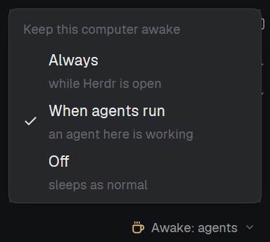

# Keep Awake for Herdr

A dropdown in Herdr's status bar that decides whether this computer may sleep:
**Always** awake while Herdr is open, awake only **When agents run**, or **Off**
(the default). Works on Windows, macOS and Linux, with nothing to install.

The mod is in [`keep-awake/`](keep-awake/): see its [`RECIPE.md`](keep-awake/RECIPE.md).
To add it, ask your agent in Herdr:

> Read ~/.config/herdr-app/AGENTS.md, then add this mod: herdr.dev/mods/amuif/herdr-keep-awake/keep-awake

The cup icon is [Lucide](https://lucide.dev)'s `coffee` (ISC license).
