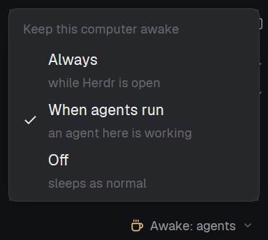

# Keep Awake

A dropdown at the right end of Herdr's status bar that decides whether this
computer may sleep. Click `Awake: off` and pick **Always** (awake while Herdr
is open), **When agents run** (awake while an agent on this computer is
working) or **Off** (sleeps as normal, the default). The cup icon lights up
while the computer is actually being held awake. Windows, macOS and Linux.

## What you see

- **Bar item** (its own block at the right end of the status bar, 150 x 28px,
  `chrome` background, 1px `border` on top, 11.8px text, content right-aligned
  with 8px side padding): a 13px cup icon, `Awake: off` / `Awake: agents` /
  `Awake: always`, and an 11px `dim` chevron-down, 6px apart. It's a rounded
  (4px) button with 6px side padding and a `hover` background.
  - Icon color: `working` while the computer is held awake, `muted` when a
    mode is on but nothing is held (agents mode, no agent working), `dim`
    when off.
  - Text color: `dim` when off, `muted` otherwise.
  - On a system it can't handle it reads `Awake: n/a` and doesn't open.
- **Menu** (`popup`, 240 x 186, `popover` background, 5px padding, 14px
  `foreground` text): the heading `Keep this computer awake` (12px `dim`),
  then three 48px rows, rounded 7px, `selected` background on hover. Each row:
  a 14px column holding a check icon on the current mode, then the title with
  its description under it (12px `dim`):
  - `Always` / `while Herdr is open`
  - `When agents run` / `an agent here is working`
  - `Off` / `sleeps as normal`
- The menu opens above the bar, centered on the click, its bottom edge 22px
  above it.

## How it behaves

- Picking a row sets the mode and closes the menu. Esc closes it too. The
  mode is kept in shared state, so it survives restarts. Default: off.
- **Always:** held awake as long as the Herdr window is open.
- **When agents run:** held awake while any terminal on this computer has
  status `working` (sub-agents without a pane count), and for 60 seconds
  after the last one stops, so pauses between steps don't drop the hold.
  `blocked`, `done` and `idle` don't count. Agents on other machines don't
  count: each machine runs its own copy with its own setting.
- **Off:** nothing is held; the helper is stopped within about 3 seconds.
- Only sleep is blocked. The display may still turn off on its usual timer.
- The hold ends about 5 seconds after Herdr quits, and 9 minutes at most
  if Herdr is killed in a way the helper can't see.
- If the helper can't start, a `Keep awake isn't working` error toast shows
  its message, and the mod tries again after a minute.
- Keys (none bound by default): `keep-awake.menu` opens the menu at the
  pointer; `keep-awake.always`, `keep-awake.agents` and `keep-awake.off`
  pick a mode directly.

## Built from

- `mods/keep-awake/` (`mod.json`: `{ "place": "none" }`), one mod used twice:
  the bar item, and with props `{ menu: true }` the menu it opens.
- Layout: turn the status block into a row and add the item after it:
  `{ "id": "status-row", "type": "row", "size": { "px": 28 }, "resizable": false, "children": [ <the status block, without its size>, { "id": "keep-awake", "type": "block", "content": { "mod": "keep-awake" }, "size": { "px": 150 } } ] }`.
- `main.js`:
  - The mode is `shared("keep-awake")`: `"always"`, `"agents"` or `"off"`
    (anything else reads as off). The menu calls `setShared` and
    `closeOverlay(props().overlay)`.
  - The bar copy checks every 3 seconds (`cx.timer.every(3000)`) whether it
    wants the computer awake: `always`, or `agents` and
    `terminals().some(t => t.status === "working" && !String(t.address).includes("/"))`
    within the last 60 seconds. If so and nothing is held, it runs the helper
    with `exec(..., { timeout: 600000 })` in a loop: each helper lives 9
    minutes, and the next starts when it ends, for as long as the hold is
    wanted. If not and something is held, it runs the helper's stop.
  - `close()` stops the helper when the bar block goes away.
  - The click's position comes from `on_mouse_down("left")` (`e.position`),
    since a click event has none; the menu is opened with
    `openOverlay({ mod: "keep-awake", kind: "popup", width: 240, height: 186, props: { menu: true }, at: { x, y } })`.
  - A `nextCommand()` loop handles the keys.
- `hold.ps1` (Windows), run as
  `powershell.exe -NoProfile -NonInteractive -ExecutionPolicy Bypass -File <appHome>/mods/keep-awake/hold.ps1 [-Stop]`:
  ends any other running copy of itself, then (unless `-Stop`) calls
  `SetThreadExecutionState(ES_CONTINUOUS | ES_SYSTEM_REQUIRED)` and waits up
  to 9 minutes, leaving early when no `herdr-app` process is left.
- `hold.sh` (macOS, Linux), run as `sh <appHome>/mods/keep-awake/hold.sh [--stop]`:
  ends any other running copy, then starts a blocker that watches the
  script's own pid: `caffeinate -i -w <pid>` on macOS,
  `systemd-inhibit --what=sleep:idle --who=Herdr --why="Keep awake" --mode=block sh -c "while kill -0 <pid>; do sleep 2; done"`
  on Linux. It then waits up to 9 minutes, leaving early when its parent
  process is gone.
- `coffee.svg`: Lucide's `coffee`, `currentColor`. The check and chevron are
  the shipped `mods/workspace-chrome/check.svg` and `chevron-down.svg`.
- Uses: `exec`, `appHome`, `window`, `terminals`, `shared` / `setShared`,
  `openOverlay` / `closeOverlay`, `props`, `notify`, `nextCommand`, `theme`.

## Watch out

- **This mod runs programs:** `powershell.exe` on Windows, `sh` with
  `caffeinate` (macOS) or `systemd-inhibit` and `pgrep` (Linux). It doesn't
  reach the network or read files outside its folder.
- Linux needs systemd (`systemd-inhibit`); without it the toast says
  `systemd-inhibit not found`.
- The macOS path is untested. Windows 11 and Arch Linux (Omarchy, Hyprland)
  are tested.
- Ask `window().platform` when it's needed, not once in `init`: right after
  the app starts it isn't known yet, and a mod that decided then would stay
  `Awake: n/a` for the whole run.
- `exec` is capped at 10 minutes, so a helper can't simply run forever:
  hence the 9-minute helper that the mod keeps restarting.
- The helper finds older copies of itself by command line. Match the way the
  mod runs it (`^sh <path>` in `pgrep -f`, `-File …hold.ps1` on Windows), not
  just the file name, or it kills an editor that has the script open.
- After a hot reload the old build's loop is still waiting on its helper.
  It must touch `cx` first thing when the helper returns, so it ends there
  instead of starting another helper and fighting the new build.
- `hold.sh` needs LF line endings (`.gitattributes` keeps them).
- The helpers are found under `mods/keep-awake/`: renaming the mod folder
  means changing that path in `main.js` and the patterns in both scripts.
- Herdr's shipped layouts are read-only: clone the layout (`layout.clone`)
  and add the block to the clone.
- A menu opened by key appears at the pointer, not above the bar item.

## Done when

- `herdr-app check` passes for `mods/keep-awake`.
- The status bar ends with the cup, `Awake: off` and a chevron, and still
  does after restarting Herdr (not `Awake: n/a`).
- `herdr-app do keep-awake.menu` opens the menu with three rows, each
  description under its title, and a check on the current mode.
- With Always picked, the bar reads `Awake: always`, the cup turns the
  `working` color, and one helper is running: a `powershell.exe` with
  `hold.ps1` on its command line on Windows; on Linux
  `systemd-inhibit --list` shows `Herdr … sleep:idle … Keep awake … block`.
- Starting the helper a second time by hand leaves exactly one running, and
  a `tail -f` on the script survives it.
- With Off picked, the helper is gone within a few seconds (and on Linux the
  inhibitor is no longer listed).
- With When agents run picked and no agent working, the cup is `muted` and
  no helper runs; once an agent on this computer starts working, the cup
  turns `working` within 3 seconds.
